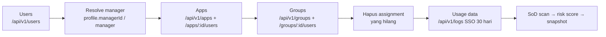

# 03 · Integrasi Okta — Cara Kerja

Integrasi berada di `src/lib/okta.ts` dan memakai **Okta Management API** dengan header `Authorization: SSWS <token>`.

## 1. Menyiapkan token

1. Okta Admin Console › **Security › API › Tokens › Create token**.
2. Isi `OKTA_ORG_URL` dan `OKTA_API_TOKEN` di `.env` (atau Settings › Integrations).
3. Klik **Test connection** — memanggil `GET /api/v1/users/me` (dan `GET /api/v1/org`) lalu menampilkan pemilik token.

## 2. Alur sinkronisasi

Dipicu oleh tombol **Sync Okta** (topbar / Settings) atau otomatis tiap `OKTA_SYNC_INTERVAL_HOURS`.

| Data Okta | Disimpan sebagai | Catatan |
|---|---|---|
| User (termasuk `DEPROVISIONED`) | `identities` | profile: login, email, nama, department, title, manager, userType/employeeType |
| `profile.managerId` / `profile.manager` | `identities.managerId` | dicocokkan ke Okta id, login, email, atau employeeNumber |
| App | `applications` + entitlement `kind: app` (`<App> - Access`) | anggota dari `/apps/:id/users` |
| Group | entitlement `kind: group` | anggota dari `/groups/:id/users`; group app-pushed dikaitkan ke aplikasinya |
| System Log `user.authentication.sso` | `assignments.lastUsedAt` | dasar *usage-aware* role mining & insight "unused" saat review |

Pagination mengikuti header `Link: rel="next"`; respons **429** ditunggu sesuai `X-Rate-Limit-Reset`.

### Klasifikasi & lifecycle otomatis

- **Tipe identitas** — `bot` / `api` / `service` bila `userType`/`employeeType` mengandung kata tersebut, atau login berawalan `svc-`, `service-`, `bot-`, `api-`, `sa-`, `system-`, `integration-`, `automation-`. Selain itu `human`.
- **Lifecycle** — `leaver` (SUSPENDED/DEPROVISIONED), `mover` (department berubah dibanding sync sebelumnya, 60 hari terakhir), `joiner` (dibuat < 30 hari), `inactive` (tidak login > 90 hari), selain itu `active`.
- **Risk entitlement** — heuristik dari nama (super admin → critical; admin/approve/release/deploy/payroll/prod → high; edit/create/manage/finance/hr → medium). Bisa diubah manual di **Apps & Entitlements** (nilai manual tidak ditimpa sync berikutnya).

## 3. Remediasi (revoke ke Okta)

Saat reviewer memilih **Revoke**:

- Campaign dengan **Auto-remediation** aktif → langsung memanggil
  - group: `DELETE /api/v1/groups/{groupId}/users/{userId}`
  - app: `DELETE /api/v1/apps/{appId}/users/{userId}`
- Hanya dieksekusi bila `OKTA_REMEDIATION_ENABLED=true` (atau toggle di Settings). Jika tidak, status remediasi = `pending` (manual), admin menerima email *certification.revoked*.
- Item `pending`/`failed` bisa diproses ulang dengan **Retry remediation** di halaman campaign.

> Default-nya **nonaktif** karena tindakan ini mengubah akses nyata di Okta.

## 4. Okta SSO (opsional)

1. Okta Admin › Applications › **Create App Integration** › OIDC › Web Application.
2. Sign-in redirect URI: `<APP_BASE_URL>/api/auth/okta/callback`.
3. Isi `OKTA_CLIENT_ID` dan `OKTA_CLIENT_SECRET`. Tombol **Sign in with Okta** muncul di halaman login.
4. User SSO baru otomatis dibuat dengan role `reviewer` — admin bisa mengubah role di Settings › Users. Reviewer melihat item yang `reviewer`-nya sama dengan email Okta mereka.
