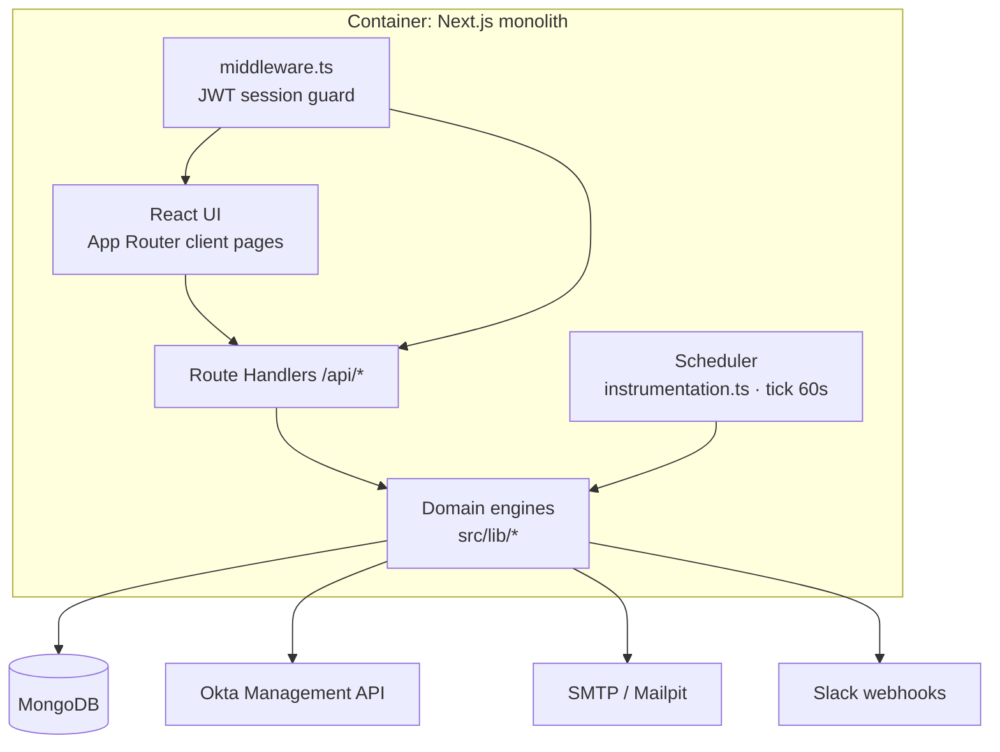

# 05 · Arsitektur

## Gambaran besar



- **Monolit**: satu image Docker berisi UI, REST API, dan background scheduler.
- **Auth**: login lokal (bcrypt) atau Okta OIDC → JWT HS256 di cookie httpOnly `iga_session` (12 jam). `middleware.ts` memblokir halaman & API tanpa sesi; `route()` wrapper memeriksa role per endpoint.
- **Scheduler**: `src/instrumentation.ts` memanggil `startScheduler()` saat server Node start. Tiap menit: report schedule jatuh tempo, campaign terjadwal; tiap jam: eskalasi & overdue; harian: SoD scan + snapshot; sesuai interval: Okta sync.

## Struktur folder

```
okta-iga/
├─ Dockerfile, docker-compose.yml, .env(.example)
├─ docs/                         dokumentasi
├─ public/favicon.svg
└─ src/
   ├─ middleware.ts              guard sesi
   ├─ instrumentation.ts         start scheduler
   ├─ app/
   │  ├─ layout.tsx              10 font (next/font), script theme anti-flash
   │  ├─ globals.css             design tokens: 5 theme × 3 design × 10 font
   │  ├─ login/                  halaman login
   │  ├─ (app)/                  halaman terproteksi (Shell: sidebar + topbar)
   │  │  ├─ dashboard/ (executive, certifications, sod, custom)
   │  │  ├─ identities/ hierarchy/ applications/
   │  │  ├─ campaigns/ (list, new, [id]) reviews/
   │  │  ├─ sod/policies sod/violations roles/
   │  │  ├─ reports/ reports/schedules workflows/ audit/ settings/
   │  └─ api/                    ±50 route handler REST
   ├─ components/                Shell, ui kit, charts, dashboard widgets, ReviewTable, CampaignForm
   └─ lib/
      ├─ models.ts               skema Mongoose
      ├─ okta.ts                 client Okta, sync, klasifikasi, remediasi
      ├─ campaigns.ts            scope, reviewer hierarchy, launch, decide, reassign, eskalasi
      ├─ sod.ts                  library predefined + SoD engine
      ├─ risk.ts                 risk scoring & snapshot tren
      ├─ roleMining.ts           mining (attribute/cluster) & optimization
      ├─ reports.ts              dataset, filter, scheduling (cron-parser)
      ├─ exporters.ts            CSV, XLSX (ExcelJS), PDF (jsPDF), JSON, HTML
      ├─ metrics.ts              agregasi dashboard
      ├─ notify.ts               workflow engine + rule default
      ├─ mailer.ts / slack.ts    channel notifikasi
      ├─ scheduler.ts            loop background
      ├─ settings.ts             konfigurasi (env + DB override, masking secret)
      ├─ seed.ts                 demo data
      └─ api.ts, jwt.ts, audit.ts, util.ts, themes.ts, client.ts
```

## Model data (MongoDB collections)

| Koleksi | Isi penting |
|---|---|
| `appusers` | user platform, role, preferensi theme/font/design |
| `identities` | identitas Okta: tipe, department, managerId, status, lifecycle, lastLogin, riskScore/Level |
| `applications` | aplikasi Okta, owner, risk |
| `entitlements` | group / app access, risk, privileged, owner |
| `assignments` | identity ↔ entitlement, grantedAt, **lastUsedAt** (usage) |
| `sodpolicies` | sisi A/B (entitlementIds + patterns regex), severity, predefined/custom |
| `sodviolations` | policy × identity, matchedA/B, status open/mitigated/accepted/remediated |
| `snapshots` | metrik harian (SoD per severity, avg risk, high risk, completion) untuk tren |
| `campaigns` | scope, reviewerHierarchy, escalation, recurrence, status, stats |
| `certitems` | item review: reviewer, level, decision, reassignHistory, remediation |
| `roles` | role mined/manual, entitlementIds, memberIds, confidence |
| `reportdefs` / `reportschedules` / `reportruns` | report builder, jadwal, riwayat |
| `workflowrules` / `notificationlogs` | workflow notifikasi & log |
| `dashboardlayouts` | layout widget per user per dashboard |
| `settings` / `auditlogs` | konfigurasi integrasi, status sync, audit |

## Engine utama

**Risk score (0–100)** = min(Σ bobot entitlement, 40) + min(Σ bobot SoD terbuka, 40) + faktor:
non-human +8 (+4 per akses privileged, maks 12), leaver dengan akses +30, inactive dengan privileged +15, mover +8.
Bobot entitlement: low 1, medium 4, high 10, critical 18. Bobot SoD: low 5, medium 10, high 20, critical 30.
Level: ≥75 critical, ≥50 high, ≥25 medium.

**SoD engine** — untuk tiap policy aktif, resolve sisi A & B (id eksplisit ∪ entitlement yang namanya cocok regex), lalu setiap identitas yang memegang a∈A dan b∈B (a≠b) menjadi violation (upsert). Violation yang tidak lagi cocok → `remediated`.

**Reviewer resolution** — iterasi `reviewerHierarchy` dari level `startLevel`; ambil email pertama yang ada dan ≠ email identitas; terakhir fallback reviewer / admin. Eskalasi memanggil fungsi yang sama dengan `startLevel = level + 1`.

**Role mining (attribute)** — kelompokkan identitas aktif human menurut atribut; entitlement dengan frekuensi/ukuran grup ≥ minSupport menjadi role (≥2 entitlement). **Cluster** — greedy clustering Jaccard ≥ threshold atas set entitlement (yang dipakai, bila usage aktif), irisan frekuensi ≥ minSupport.

## Skalabilitas & catatan produksi

- Scheduler in-process → jalankan **1 replika**. Untuk HA, pisahkan scheduler ke container worker dengan entrypoint sendiri.
- Sync memanggil API per app & per group; untuk org besar perhatikan rate limit Okta (sudah ada backoff 429).
- Tambahkan backup volume MongoDB dan reverse proxy TLS.
